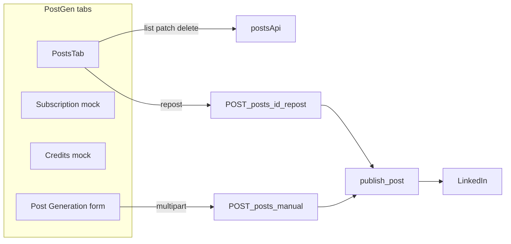

# Post Gen tabbed page (TS-1)

## Decisions locked

| ID | Choice |
|----|--------|
| Q-1 | **A** — Posts from `postsApi.list` |
| Q-2 | **C** — New backend: title/description/tags/image → create + publish to LinkedIn |
| Q-3 | **A** — Remove Voice & style + Content queue from this page |
| Q-4 | **A** — Subscription + Credits mock packages UI-only |
| Q-5 | **A** — Tabs: Posts \| Subscription \| Credits \| Post Generation |
| Q-6 | **A** — Edit = patch text modal; Delete = `postsApi.delete`; Repost = duplicate + publish |
| Q-7 | Form fields are first-class on the new API |

**Storage default (no DB migration):** Compose LinkedIn body as `title` + blank line + `description` + tags as hashtags into `posts.generated_text`. Persist raw form fields as JSON in existing `prompt_text` (e.g. `{"manual":true,"title":"...","tags":[...]}`). Save uploaded image under existing `/uploads` static dir and set `image_url`. Avoids G10 migration this sprint.

## Architecture

## Backend (new contracts)

Files: [`posts.py`](delegtlabs/packages/agents/linkedin_agent/backend/app/api/endpoints/posts.py), [`app/schemas/post.py`](delegtlabs/packages/agents/linkedin_agent/backend/app/schemas/post.py), [`publish.py`](delegtlabs/packages/agents/linkedin_agent/backend/app/services/publish.py) (reuse), image save pattern from [`grok.py`](delegtlabs/packages/agents/linkedin_agent/backend/app/services/grok.py) (`/uploads/{name}`).

1. **`POST /posts/manual`** (multipart/form-data)
   - Fields: `title` (required), `description` (required), `tags` (optional string, comma-separated), `image` (optional file)
   - Validate non-empty title/description; enforce LinkedIn char limit on composed body (3000)
   - Write image to uploads dir if present; build `generated_text` + `prompt_text` JSON
   - Insert post (`status` draft), then call existing `publish_post(id)` (compliance gate unchanged)
   - Return published (or failed/held) post payload

2. **`POST /posts/{id}/repost`**
   - Load source post; 404 if missing
   - Insert clone (`generated_text`, `image_url`, `prompt_text` with `repost_of`)
   - Call `publish_post(new_id)`
   - Return new post

No change to existing `/posts/generate` AI pipeline.

## Frontend API client

[`frontend/shared/api/index.ts`](delegtlabs/packages/agents/linkedin_agent/frontend/shared/api/index.ts):

- `postsApi.manualPublish(formData: FormData)` → `POST /posts/manual` (multipart)
- `postsApi.repost(id: number)` → `POST /posts/{id}/repost`

## Frontend page rewrite

Entry: [`PostGen.tsx`](delegtlabs/packages/agents/linkedin_agent/frontend/user/src/pages/agents/PostGen.tsx) (route unchanged in [`App.tsx`](delegtlabs/packages/agents/linkedin_agent/frontend/user/src/App.tsx:143)).

**Keep:** inactive-agent gate → billing CTA.

**Remove:** Voice & style card, Content queue / `PostCard` queue UI, header “Generate Post” that calls `postsApi.generate`.

**Add tab shell** using existing [`tabs.tsx`](delegtlabs/packages/agents/linkedin_agent/frontend/shared/components/ui/tabs.tsx). Split into colocated modules under `pages/agents/post-gen/` so no file exceeds 500 lines:

| File | Responsibility |
|------|----------------|
| `PostGen.tsx` | PageHeader + Tabs + inactive gate |
| `post-gen/PostsTab.tsx` | Table + actions + lightbox + edit dialog |
| `post-gen/SubscriptionTab.tsx` | Mock current plan + upgrade/downgrade/purchase cards |
| `post-gen/CreditsTab.tsx` | Mock packages + faux purchase history |
| `post-gen/PostGenerationTab.tsx` | Manual form → `manualPublish` |
| `post-gen/mock-billing.ts` | Static plan/credit package data |

### Posts tab

- `postsApi.list({ limit: 50 })` via react-query
- Table columns: thumbnail, text excerpt, status, created, actions
- Thumbnail click → Dialog lightbox (existing [`dialog.tsx`](delegtlabs/packages/agents/linkedin_agent/frontend/shared/components/ui/dialog.tsx))
- **Edit:** Dialog + Textarea → `postsApi.patch(id, { generated_text })`
- **Delete:** confirm → `postsApi.delete`
- **Repost:** `postsApi.repost` + invalidate list
- Empty state when `total === 0`

### Subscription / Credits tabs

- Local mock catalogs only (no `tenantApi.billing` / `buyCredits`)
- UI: current plan badge, plan cards with Upgrade/Downgrade/Purchase buttons (toast or local state only)
- Credits: packages + “purchased” history seeded in component state after click

### Post Generation tab

- Inputs: Title, Description, Tags, Image file upload (preview)
- Submit → `FormData` → `postsApi.manualPublish`; loading + success/error; invalidate `["posts"]` queries on success

## Panel execution (after you approve this plan)

1. Bootstrap `.agent/` if missing; persist Task Spec + Fact Sheet  
2. Wave 2: lock contracts for `/posts/manual` and `/posts/{id}/repost` in `.agent/contracts/` (human confirm — new API)  
3. Wave 3 parallel: backend-engineer + frontend-engineer + qa-test-engineer (≤4)  
4. Wave 4: red-team → verification-gate  
5. Wave 5: release Decision Record  

## Out of scope

- Matchifyx; Lead Gen / Analytics pages; real Stripe/billing wire; Voice & style relocation; DB column migration for title/tags; changing `/dashboard/billing`

## Acceptance (binary)

- `/dashboard/agents/post-gen` shows four tabs in locked order  
- Posts table loads real posts; lightbox; edit/delete/repost work as specified  
- Subscription + Credits show mock packages only  
- Post Generation form creates + publishes via new endpoint (compliance may hold/block as today)  
- Old Voice & style + Content queue gone from this page  
- Inactive gate preserved; files ≤500 LOC; no Matchifyx